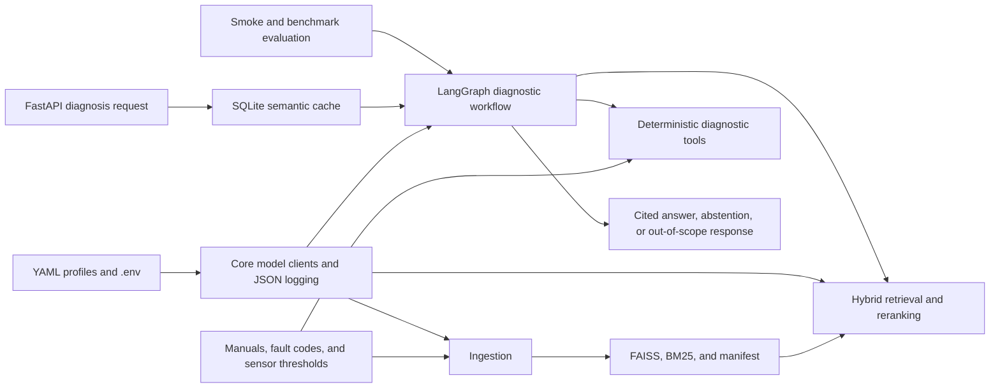

# DiagAgent-RAG

Retrieval-augmented diagnostics for industrial equipment, using English maintenance
manuals and structured fault and sensor data by default. Phase 1 provides typed
configuration, model clients, JSON logging, and an offline CI baseline.

## Target architecture



## Local setup

Run these commands from the repository root with Python 3.10 or 3.11.

```powershell
python -m venv .venv
.\.venv\Scripts\Activate.ps1
python -m pip install -r requirements.txt
ruff check .
pytest -q
python -m pytest -q tests/test_mock_smoke.py
```

On Linux, activate the environment with `source .venv/bin/activate`.
The default profile uses deterministic Mock clients and needs no API key or model download.

## Configuration

`load_settings()` reads `configs/default.yaml` from the working directory by default.
Pass a profile path or provide `project_root` to run from a different directory.
Process environment variables override `.env`, then YAML, then model defaults.
Set nested fields with names such as `DIAGAGENT_LLM__MODEL`. Store API keys in the
environment or an ignored `.env` file using [the template](.env.example).

The Colab profile assumes Google Drive is mounted at `/content/drive` and uses CUDA
for Sentence Transformer embeddings and Cross-Encoder reranking. Install those
providers with `python -m pip install -e ".[huggingface]"`. The OpenAI-compatible LLM
and embedding clients accept an injectable HTTP transport for offline contract tests.
Set `DIAGAGENT_LLM__API_KEY` or `DIAGAGENT_EMBEDDING__API_KEY` for the corresponding
live provider. [OpenAI API reference](https://developers.openai.com/api/reference/) ·
[Sentence Transformers documentation](https://www.sbert.net/)

## Verification status

Phase 1 smoke coverage exercises configuration, deterministic model clients, equipment
code ranking, and structured logs. Later phases add corpus indexing, diagnosis and
evaluation. Real-model benchmark results are **TBD (run Colab benchmark)**.
