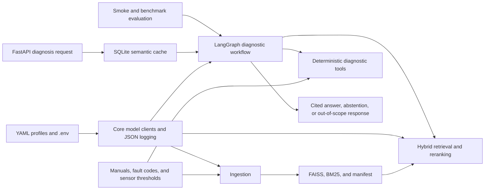

# DiagAgent-RAG

Retrieval-augmented diagnostics for industrial equipment, using English maintenance
manuals and structured fault and sensor data by default. The first two phases
provide typed configuration, model clients, corpus indexing, hybrid retrieval,
and offline CI.

## Target architecture



## Local setup

Run these commands from the repository root with Python 3.10 or 3.11.

```powershell
python -m venv .venv
.\.venv\Scripts\Activate.ps1
python -m pip install -r requirements.txt
ruff check .
ruff format --check .
pytest -q
python scripts/ingest.py
python -m pytest -q tests/test_mock_smoke.py
```

On Linux, activate the environment with `source .venv/bin/activate`.
The default profile uses deterministic Mock clients and needs no API key or model download.

## Configuration

`load_settings()` reads `configs/default.yaml` from the working directory by default.
Pass a profile path or provide `project_root` to run from a different directory.
Process environment variables override `.env`, then YAML, then model defaults.
Set nested fields with names such as `DIAGAGENT_LLM__MODEL`. Store API keys in the
environment or an ignored `.env` file using [the template](.env.example).

The Colab profile assumes Google Drive is mounted at `/content/drive` and uses CUDA
for Sentence Transformer embeddings and Cross-Encoder reranking. Install those
providers with `python -m pip install -e ".[huggingface]"`. The OpenAI-compatible LLM
and embedding clients accept an injectable HTTP transport for offline contract tests.
Set `DIAGAGENT_LLM__API_KEY` or `DIAGAGENT_EMBEDDING__API_KEY` for the corresponding
live provider. [OpenAI API reference](https://developers.openai.com/api/reference/) ·
[Sentence Transformers documentation](https://www.sbert.net/)

Use the project virtual environment when importing `src.core`. Use OpenAI-compatible
clients as context managers or call `close()` to release their connection pools.
The settings support `max_retries` for each HTTP client, `batch_size` for embeddings,
and optional `temperature` and `max_completion_tokens` for chat completion.
Embedding results are finite `float32` arrays with L2-normalized nonzero rows.

## Corpus and hybrid search

`data/raw/` contains five authored English sample manuals, `fault_codes.csv`,
and `sensor_thresholds.json`. The asset identifiers, fault mappings, and
thresholds belong to the sample fleet. Use equipment-specific documentation
for field decisions.

Ingestion accepts Markdown headings, text-bearing PDF pages, CSV rows, and
JSON records. Scanned PDFs require OCR before ingestion. Each chunk records
its source path, section, PDF page when available, and a stable identifier
such as `manuals/vfd_faults.md#s1#c0`.

`python scripts/ingest.py` writes `data/index/manifest.json` after writing a
complete generation under `data/index/generations/`. A generation contains
UTF-8 `chunks.jsonl` and an inner-product `vectors.faiss` index. Loading checks
the embedding provider, model, dimension, chunk settings, and artifact
checksums. BM25 rebuilds from the JSONL chunks and uses complete equipment
codes and component terms. Copy the manifest and its referenced generation
together when moving an index between systems. Previous generations are
retained so readers of an earlier manifest can finish. Load indices from
trusted sources. [FAISS index I/O](https://github.com/facebookresearch/faiss/wiki/Index-IO%2C-cloning-and-hyper-parameter-tuning)

```python
from src.core.embedding import create_embedding_client
from src.core.reranker import create_reranker
from src.core.settings import load_settings
from src.retrieval.hybrid import HybridRetriever
from src.retrieval.index import load_index

settings = load_settings()
index = load_index(settings.paths.index_dir, settings.embedding, settings.ingestion)
with create_embedding_client(settings.embedding) as embedding:
    search = HybridRetriever(
        index, embedding, create_reranker(settings.reranker), settings=settings.retrieval
    )
    for hit in search.search("VFD-OC3 acceleration overcurrent", top_k=3):
        print(hit.chunk.chunk_id, hit.score)
```

Use `search.dense.search()` or `search.bm25.search()` for individual rankings,
and `search.search(..., rerank=False)` for RRF without reranking. The reranker
score scale is provider-specific. Search results retain the available
component scores for evaluation.

## Verification status

Offline checks exercise configuration, deterministic model clients, parsers,
chunking, index compatibility, and four retrieval modes. Later phases add
diagnosis and evaluation. Real-model benchmark results are
**TBD (run Colab benchmark)**.
