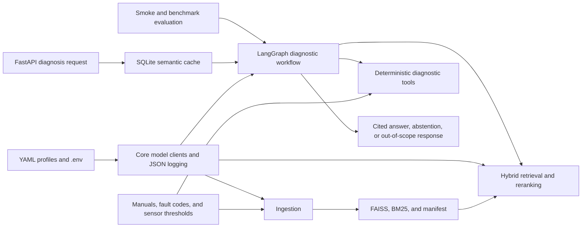

# DiagAgent-RAG

Retrieval-augmented diagnostics for industrial equipment, using English maintenance
manuals and structured fault and sensor data by default. The implemented
workflow indexes that corpus, retrieves evidence, and runs a typed diagnostic
graph with offline Mock and OpenAI-compatible model policies. A FastAPI service
exposes the workflow, and an evaluation runner compares four retrieval modes.

## Target architecture



## Local setup

Run these commands from the repository root with Python 3.10 or 3.11.

```powershell
python -m venv .venv
.\.venv\Scripts\Activate.ps1
python -m pip install -r requirements.txt
ruff check .
ruff format --check .
pytest -q
python scripts/ingest.py
python scripts/verify_e2e.py
```

On Linux, activate the environment with `source .venv/bin/activate`.
The default profile uses deterministic Mock clients and needs no API key or model download.

## Configuration

`load_settings()` reads `configs/default.yaml` from the working directory by default.
Pass a profile path or provide `project_root` to run from a different directory.
Process environment variables override `.env`, then YAML, then model defaults.
Set nested fields with names such as `DIAGAGENT_LLM__MODEL`. Store API keys in the
environment or an ignored `.env` file using [the template](.env.example).

The Colab profile assumes Google Drive is mounted at `/content/drive` and uses CUDA
for Sentence Transformer embeddings and Cross-Encoder reranking. Install those
providers with `python -m pip install -e ".[huggingface]"`. The OpenAI-compatible LLM
and embedding clients accept an injectable HTTP transport for offline contract tests.
Set `DIAGAGENT_LLM__API_KEY` or `DIAGAGENT_EMBEDDING__API_KEY` for the corresponding
live provider. [OpenAI API reference](https://developers.openai.com/api/reference/) ·
[Sentence Transformers documentation](https://www.sbert.net/)

Use the project virtual environment when importing `src.core`. Use OpenAI-compatible
clients as context managers or call `close()` to release their connection pools.
The settings support `max_retries` for each HTTP client, `batch_size` for embeddings,
and optional `temperature` and `max_completion_tokens` for chat completion.
Embedding results are finite `float32` arrays with L2-normalized nonzero rows.

## Corpus and hybrid search

`data/raw/` contains five authored English sample manuals, `fault_codes.csv`,
and `sensor_thresholds.json`. The asset identifiers, fault mappings, and
thresholds belong to the sample fleet. Use equipment-specific documentation
for field decisions.

Ingestion accepts Markdown headings, text-bearing PDF pages, CSV rows, and
JSON records. Scanned PDFs require OCR before ingestion. Each chunk records
its source path, section, PDF page when available, and a stable identifier
such as `manuals/vfd_faults.md#s1#c0`.

`python scripts/ingest.py` writes `data/index/manifest.json` after writing a
complete generation under `data/index/generations/`. A generation contains
UTF-8 `chunks.jsonl` and an inner-product `vectors.faiss` index. Loading checks
the embedding provider, model, dimension, chunk settings, and artifact
checksums. BM25 rebuilds from the JSONL chunks and uses complete equipment
codes and component terms. Copy the manifest and its referenced generation
together when moving an index between systems. Previous generations are
retained so readers of an earlier manifest can finish. Load indices from
trusted sources. [FAISS index I/O](https://github.com/facebookresearch/faiss/wiki/Index-IO%2C-cloning-and-hyper-parameter-tuning)

```python
from src.core.embedding import create_embedding_client
from src.core.reranker import create_reranker
from src.core.settings import load_settings
from src.retrieval.hybrid import HybridRetriever
from src.retrieval.index import load_index

settings = load_settings()
index = load_index(settings.paths.index_dir, settings.embedding, settings.ingestion)
with create_embedding_client(settings.embedding) as embedding:
    search = HybridRetriever(
        index, embedding, create_reranker(settings.reranker), settings=settings.retrieval
    )
    for hit in search.search("VFD-OC3 acceleration overcurrent", top_k=3):
        print(hit.chunk.chunk_id, hit.score)
```

Use `search.dense.search()` or `search.bm25.search()` for individual rankings,
and `search.search(..., rerank=False)` for RRF without reranking. The reranker
score scale is provider-specific. Search results retain the available
component scores for evaluation.
BM25 reports raw Okapi scores, which can be negative for terms that occur in
most documents in a small corpus. The critic checks evidence and citations
independently of these ranking scores.

## Run a diagnosis

After building and loading the index as above, keep the embedding client
open for the full duration of the diagnosis.

```python
from src.agents.schemas import DiagnosticRequest
from src.agents.workflow import create_diagnostic_workflow

with create_embedding_client(settings.embedding) as embedding:
    search = HybridRetriever(
        index, embedding, create_reranker(settings.reranker), settings=settings.retrieval
    )
    workflow = create_diagnostic_workflow(settings, search)
    result = workflow.invoke(
        DiagnosticRequest(query="What does VFD-OC3 mean?", equipment_id="DRV-300")
    )
    print(result.model_dump_json(indent=2))
```

The LangGraph path is intent router → retriever → diagnostic tool →
synthesizer → critic. The router ends out-of-scope requests immediately.
The critic can refine the query and expand retrieval up to twice. On
exhaustion the workflow returns `insufficient_evidence` with a checklist and
an escalation recommendation. Answered responses carry inline citations
and structured source metadata. The default trace records transitions,
latencies and retry counts. [LangGraph Graph API](https://docs.langchain.com/oss/python/langgraph/graph-api)

The deterministic tools load `fault_codes.csv` and `sensor_thresholds.json`.
Supply sensor readings in the unit recorded in the table. Threshold
comparisons include equality, and readings shared across multiple equipment
types need an unambiguous asset ID. Mock mode uses lexical routing and
extractive evidence checks and keeps tracing local. To use an OpenAI-compatible
profile, inject its open `llm_client` when creating the diagnostic workflow.

## FastAPI and semantic cache

Start the local service with the project's virtual environment active.

```powershell
python scripts/run_api.py
```

Use a second PowerShell session to build the configured index and submit a
diagnosis. `GET /health` reports `not_ready` until a compatible index is loaded.
The [interactive API documentation](http://127.0.0.1:8000/docs) lists the full
request and response schemas.

```powershell
Invoke-RestMethod 'http://127.0.0.1:8000/v1/ingest' -Method Post
$diagnosis = @{ query = 'What does VFD-OC3 mean?'; equipment_id = 'DRV-300' } | ConvertTo-Json
Invoke-RestMethod 'http://127.0.0.1:8000/v1/diagnose' -Method Post -ContentType 'application/json' -Body $diagnosis
```

The SQLite cache stores grounded answers under the index version, model
profile, and a normalized case context that includes equipment, fault codes,
exact sensor values, and rule units. A query must meet cosine similarity of
at least 0.95 within that scope. `bypass_cache` skips both lookup and write.
The API emits traces for fresh responses when `include_trace` is enabled
and sets `cache_hit` when reusing an answer. Keep the cache file on the
local filesystem. Rebuild the index through the running service to publish
a new snapshot for subsequent requests and remove cache rows for older index
versions. The Colab profile keeps its SQLite file under `/content/diagagent-cache/`.

## Evaluation and Colab

Use the current index with either labeled dataset.

```powershell
python scripts/evaluate.py --dataset data/eval/golden_smoke.jsonl
python scripts/evaluate.py --config configs/colab.yaml --dataset data/eval/golden_bench.jsonl
```

The smoke set contains 15 cases, including three abstention or out-of-scope
cases. The benchmark set contains 54 cases, including eight abstention or
out-of-scope cases. Both sets use the shipped sample corpus. The runner writes
timestamped JSON and Markdown under the configured reports directory.
Reports identify the dataset hash, index and model profile. They include
Recall@K, MRR@K, NDCG@K, citation and tool metrics, routing and abstention
accuracy, and P50/P95 workflow latency. Add `--judge` to a live run for
optional faithfulness scoring with the configured LLM. The CLI prints progress
as each mode completes. A failed judge call leaves that case's faithfulness
unscored. Reports retain the case and count valid judge scores in
`judge_samples`.

Open [colab_gpu_pipeline.ipynb](notebooks/colab_gpu_pipeline.ipynb) in Colab
with a GPU runtime. The notebook mounts Drive, uses the repository at
`MyDrive/DiagAgent-RAG`, and reads the secret `DIAGAGENT_LLM_API_KEY`.
It installs a Python 3.11 environment, checks CUDA, builds the index with
GPU embeddings, and compares all four modes on the benchmark set. The
matching cell script is
[colab_gpu_pipeline.py](notebooks/colab_gpu_pipeline.py). Gateway profiles
can opt into JSON mode with `llm.json_mode` and choose the token-limit
parameter their endpoint supports.

### Live Colab benchmark

The 2026-11-26 run evaluated all 54 cases in `golden_bench.jsonl` in each of
the four retrieval modes (216 diagnoses). It reused the index verified in the
15-case live smoke run, used `top_k=5`, and ran with the LLM judge disabled.
[Full benchmark report](reports/benchmarks/20261126T082538306476Z_live_golden_bench.md).

- Code commit `3710eab2e151da04db2e330e5d6b7ddc30ec707f`.
- Dataset SHA-256 `20e01b827fd435385b88d65d6311b333b305747a57562c875745ffc57e8ec43e`.
- Index version `v1-97aeb4683258e0a6fab3889fa493b39a323760ba1bf333f67032f6632ad293ea`.
- The Drive copy of `configs/colab.yaml` used `https://api.deepseek.com`
  with `deepseek-flash`, `temperature=0`, and `json_mode=true`. Its SHA-256
  was `43e99db74c5e15ab628135e480572c18005561bb37bd807f76956c51d82511b7`.
- Embedding used `sentence-transformers/all-MiniLM-L6-v2` (384 dimensions).
  Reranking used `cross-encoder/ms-marco-MiniLM-L6-v2`. Both ran on a Tesla T4
  with 15 GiB VRAM, CUDA 13.2, Python 3.11.18, PyTorch `2.15.0+cu132`,
  sentence-transformers 5.7.0, and transformers 5.24.1. The index used
  faiss-cpu 1.12.0.

| Metric | `dense_only` | `bm25_only` | `hybrid_rrf` | `hybrid_rerank` |
|---|---:|---:|---:|---:|
| Recall@5 | 0.9022 | 0.9493 | 0.9710 | 0.9783 |
| MRR@5 | 0.8605 | 0.9239 | 0.9783 | 0.9239 |
| NDCG@5 | 0.8636 | 0.9142 | 0.9602 | 0.9328 |
| Citation coverage | 0.8804 | 0.9130 | 0.9565 | 0.9565 |
| Citation validity | 1.0000 | 1.0000 | 1.0000 | 1.0000 |
| Routing accuracy | 0.7593 | 0.7222 | 0.7222 | 0.7963 |
| Tool accuracy | 0.9032 | 1.0000 | 1.0000 | 1.0000 |
| Abstention accuracy | 0.9074 | 0.9259 | 0.9630 | 0.9630 |
| Status accuracy | 0.9074 | 0.9259 | 0.9630 | 0.9630 |
| P50 latency (ms) | 8,135.82 | 7,450.93 | 8,668.94 | 8,119.53 |
| P95 latency (ms) | 21,605.59 | 22,700.93 | 23,553.68 | 22,953.43 |

The table reports end-to-end behavior. The live router ran independently in
each mode. Five invalid intent responses and three `out_of_scope` decisions on
the in-domain case `bench-23` stopped the workflow before retrieval and tools.
These decisions account for most of the dense-only Recall@5 gap and all three
of its tool misses. Dense-only tool accuracy was 28/31 end to end and 28/28 on
cases that reached tool execution.

The first-pass comparison below uses the **same 41 gold-evidence cases** that
reached retrieval and returned candidates in every mode. It describes that
shared subset of this run.

| First-pass metric (41 shared cases) | `dense_only` | `bm25_only` | `hybrid_rrf` | `hybrid_rerank` |
|---|---:|---:|---:|---:|
| Recall@5 | 0.9878 | 0.9919 | 0.9919 | 1.0000 |
| MRR@5 | 0.9411 | 0.9634 | 1.0000 | 0.9390 |
| NDCG@5 | 0.9445 | 0.9534 | 0.9825 | 0.9503 |

`hybrid_rrf` ranked the first gold result highest on average, and
`hybrid_rerank` recovered all gold chunks on the shared subset, including the
chunk that RRF missed on the first pass of `bench-22`. Both matched the
expected final status in 52 of 54 cases. All 171 answered results passed the
citation ID check. The optional judge was disabled.

The Colab cell log recorded 678 policy-layer LLM calls and six schema
failures (five intent and one critic). The standard JSON report records the
five missing intents. The call count and critic failure come from the cell
log. All four modes returned `insufficient_evidence` for `bench-19`, whose
original label was `answered`. The cited manual lists observations to collect
and describes similar indications from several causes, while the question
asks how to distinguish two of those causes.

The four mode runs took 35.3 minutes in total. The latency rows measure the
full diagnosis workflow, including remote calls to `deepseek-flash`. The
connectivity probe returned reasoning output.

#### Routing candidate on the Qianwen gateway

Run `20261126T111043719954Z` evaluated the same four retrieval modes on 54
labeled cases per mode, using `top_k=5`, the index above, and the judge disabled.
This full benchmark used `llm-critic-v2`, before the critic's evidence
requirements were tightened. The Drive profile used `deepseek-v4.1-flash`
through the Qianwen OpenAI-compatible gateway. The embedding and reranking
models and the Tesla T4 environment matched the run above. The candidate
dataset SHA-256 was
`21ec517f4455a60faa3e8bf1c2219af3506a42976fec24acd51e960425382dd1`.
The Drive profile SHA-256 was
`240d3cae7deb282e4a9fa974e60c0895d916f5754c304f129c2c04e2cbcd8d16`.
The six-file runtime patch used for this run had SHA-256
`e62e88bc13fb310f1715d78ee9261fdbb64946d86ef9bdba590ac7f0b29745e8`.
[Candidate benchmark report](reports/benchmarks/20261126T111043719954Z_live_golden_bench.md).

| Metric | `dense_only` | `bm25_only` | `hybrid_rrf` | `hybrid_rerank` |
|---|---:|---:|---:|---:|
| Gold-evidence cases reaching retrieval | 46/46 | 46/46 | 46/46 | 46/46 |
| Recall@5 | 0.9891 | 0.9928 | 0.9928 | 1.0000 |
| MRR@5 | 0.9366 | 0.9674 | 1.0000 | 0.9457 |
| NDCG@5 | 0.9423 | 0.9577 | 0.9820 | 0.9545 |
| Citation coverage | 0.9891 | 1.0000 | 1.0000 | 1.0000 |
| Citation validity | 1.0000 | 1.0000 | 1.0000 | 1.0000 |
| Routing accuracy | 1.0000 | 0.9630 | 1.0000 | 0.9630 |
| Tool accuracy | 1.0000 | 1.0000 | 1.0000 | 1.0000 |
| Abstention accuracy | 0.9815 | 0.9815 | 1.0000 | 1.0000 |
| Status accuracy | 0.9815 | 0.9815 | 1.0000 | 1.0000 |
| P50 latency (ms) | 7,847.34 | 7,530.94 | 6,806.97 | 7,393.68 |
| P95 latency (ms) | 23,478.55 | 17,731.85 | 15,908.14 | 20,508.56 |

All 186 answered results passed the citation ID and metadata check. Semantic
faithfulness was unmeasured. A companion Colab `.telemetry.json` file recorded
674 schema-valid policy calls, zero schema rejections and zero route retries.
The four mode runs took 30.8 minutes in total. The rewritten `bench-19` was
answered in all four modes. Dense-only and BM25-only both answered `bench-47`,
which expects `insufficient_evidence` because the corpus lacks the authorized
MX-200 terminal torque. The archived report preserves status and citation IDs,
so the exact answer text is unknown. BM25-only and Hybrid Rerank also mapped
`bench-10` and `bench-26` to `parameter_lookup`.

The candidate changed the routing policy, LLM, gateway, and `bench-19`
wording. Isolating the routing policy's effect requires a paired run on
the unchanged cases with the same model and gateway.

#### Targeted follow-up

Follow-up run `20261126T114134427256Z` used the tightened critic and cache policy
`llm-critic-v3` on the same Qianwen model and index. The SHA-256 of
`src/agents/policy.py` used in this run was
`6d3a1e004c3c9289df14d90a17c5ac32723a5741aff8a0537b291179da1bf3cf`.
The raw `abstention`, `paired_routes`, and `judge_smoke` JSON reports are
archived locally in the Git-ignored `reports/generated/` directory.

`bench-47`, `bench-48`, and `bench-52` each returned `insufficient_evidence`
in all four retrieval modes across two runs per mode (24/24).
The eight `bench-47` responses reported the missing torque
specification and provided no torque value.

On the 53 unchanged benchmark cases, the legacy and candidate router prompts
scored 42/53 and 52/53, respectively, using the same model and gateway and
one policy-layer attempt per prompt. Both were correct on 42 cases, only the
candidate was correct on 10, and both missed `bench-26`. This comparison
measures first-pass routing on these cases.

In a separate `hybrid_rrf` smoke, all 15 final statuses matched the reference.
The same model scored the 12 answered cases, with mean faithfulness of 0.9917
and no judge errors. Abstentions and out-of-scope cases received no score.

#### Full `llm-critic-v3` regression

Run `20261126T123320700668Z` evaluated 54 cases per mode with the same
Qianwen gateway, model, dataset, index, and `top_k=5` as the v2 candidate.
The optional judge was disabled. The four mode runs took 31.35 minutes in
total. The v3 policy SHA-256 is recorded above.
[Full v3 benchmark report](reports/benchmarks/20261126T130453638391Z_live_golden_bench.md).

| Outcome | Dense only | BM25 only | Hybrid RRF | Hybrid rerank |
|---|---:|---:|---:|---:|
| Correct final status (v2 → v3) | 53/54 → 53/54 | 53/54 → 53/54 | 54/54 → 53/54 | 54/54 → 53/54 |
| Gold-answerable cases answered (v2 → v3) | 46/46 → 45/46 | 46/46 → 45/46 | 46/46 → 45/46 | 46/46 → 45/46 |
| Gold evidence-insufficient cases answered in error (v2 → v3) | 1/6 → 0/6 | 1/6 → 0/6 | 0/6 → 0/6 | 0/6 → 0/6 |
| v3 answers with valid citations | 45/45 | 45/45 | 45/45 | 45/45 |

`bench-47` now returns `insufficient_evidence` in all four modes.
`bench-27` is the only new status regression and prevents passing the
zero-false-refusal criterion. It returns `insufficient_evidence` in every
mode despite retrieving both annotated sections in the first pass and
using both workflow retries. The question permits a qualitative reading
of the manual, while the final missing-evidence lists ask for duty-point
values and field observations. The run saved final answers and node
traces. Antigravity independently verified the artifacts and reproduced all
216 paired comparisons. A 12-run follow-up with the same v3 policy and
index reproduced three refusals in four `bench-27` runs. All ten drafts
sent to the critic for this case cited both annotated sections and
explained the qualitative comparison. Nine critic decisions asked for
duty-point values and field observations before approving an answer.
The v4 candidate clarifies the evidence requirement for qualitative
guidance. In the 12-run v4 follow-up, all four `bench-27` runs answered on
the first attempt. Both answerable controls and all six insufficient-evidence
controls returned the expected status. First-pass rankings matched v3
in all 12 runs.

#### Full `llm-critic-v4` regression

Run `20261127T022823191425Z` used the same model, dataset, index, and
`top_k=5` as v3. The cache profile uses `llm-critic-v4`, and the SHA-256
of `src/agents/policy.py` is
`815441297333e96087e779cf5306ed68ea0741b241542c2143e6871fcf432e08`.
Every retrieval mode correctly answered all 46 answerable
cases, abstained on all six insufficient-evidence cases, and identified
both out-of-scope cases. The four status changes from v3 were all
`bench-27` recoveries. First-pass rankings matched v3 across all 216
case-mode pairs. All 184 answers passed citation validation. `bench-26`
retained its routing mismatch across all four modes, and `bench-10` had a
routing mismatch in Dense only. Both cases answered in all modes. The
four mode runs took 28.45 minutes in total. Independent Judge scoring
used `qwen-plus-2025-12-01` on the 46 frozen Hybrid RRF answers with
their original requests, cited evidence, and tool findings. All 46
received a score, with a mean faithfulness of 0.9826. There were 42 scores
of 1.0 and four of 0.8. `bench-27` received 1.0. The two `smoke-06` runs,
with and without the structured request, each received 1.0.
[Full v4 benchmark report](reports/benchmarks/20261127T025706075569Z_live_golden_bench.md).

`python scripts/verify_e2e.py` is the offline Antigravity entry point. It
uses temporary index, cache and report paths and exercises ingestion, the
manifest, the FastAPI request paths and all four Mock evaluation modes.
