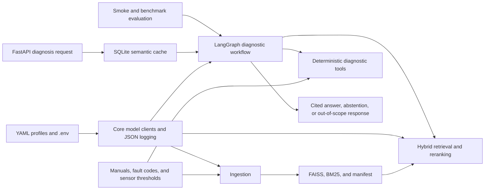
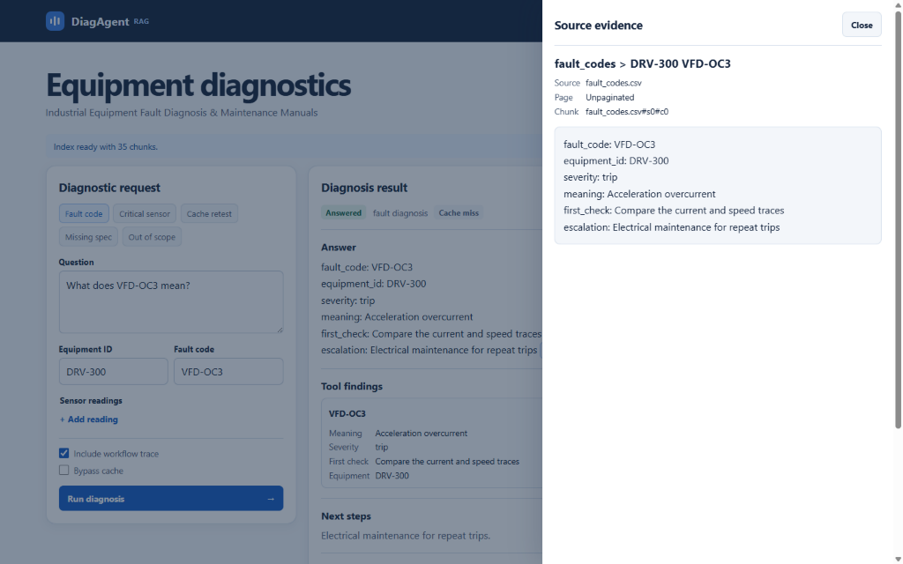
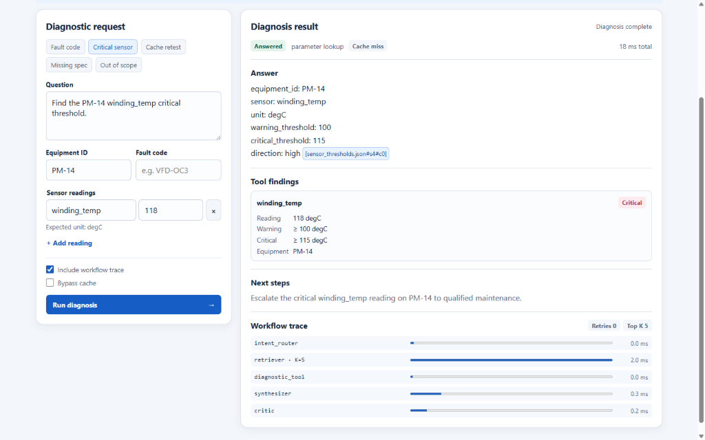
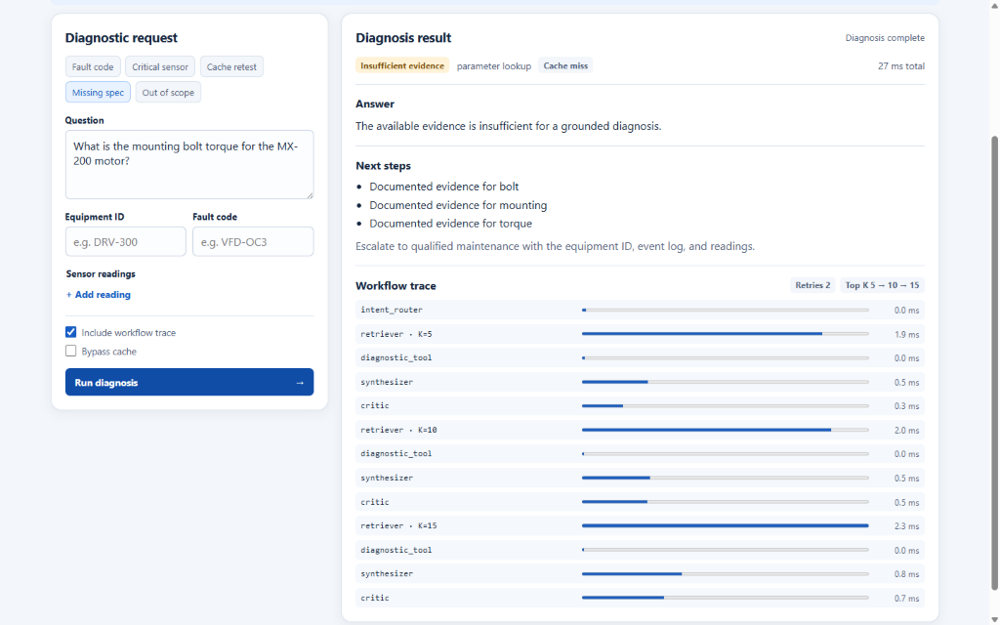

# DiagAgent-RAG

Retrieval-augmented diagnostics for industrial equipment, using English maintenance
manuals and structured fault and sensor data by default. The implemented
workflow indexes that corpus, retrieves evidence, and runs a typed diagnostic
graph with offline Mock and OpenAI-compatible model policies. A FastAPI service
exposes the workflow, and an evaluation runner compares four retrieval modes.

To adapt this repository as a template for your own equipment fleet, corpus, or
internal deployment, see [the customization guide](docs/CUSTOMIZATION.md).

## Target architecture



## Local setup

Run these commands from the repository root with Python 3.10 or 3.11.

```powershell
python -m venv .venv
.\.venv\Scripts\Activate.ps1
python -m pip install -r requirements.txt
ruff check .
ruff format --check .
pytest -q
python scripts/ingest.py
python scripts/verify_e2e.py
```

On Linux, activate the environment with `source .venv/bin/activate`.
The default profile uses deterministic Mock clients and needs no API key or model download.

## Configuration

`load_settings()` reads `configs/default.yaml` from the working directory by default.
Pass a profile path or provide `project_root` to run from a different directory.
Process environment variables override `.env`, then YAML, then model defaults.
Set nested fields with names such as `DIAGAGENT_LLM__MODEL`. Store API keys in the
environment or an ignored `.env` file using [the template](.env.example).

The Colab profile assumes Google Drive is mounted at `/content/drive` and uses CUDA
for Sentence Transformer embeddings and Cross-Encoder reranking. Install those
providers with `python -m pip install -e ".[huggingface]"`. The OpenAI-compatible LLM
and embedding clients accept an injectable HTTP transport for offline contract tests.
Set `DIAGAGENT_LLM__API_KEY` or `DIAGAGENT_EMBEDDING__API_KEY` for the corresponding
live provider. [OpenAI API reference](https://developers.openai.com/api/reference/) ·
[Sentence Transformers documentation](https://www.sbert.net/)

Use the project virtual environment when importing `src.core`. Use OpenAI-compatible
clients as context managers or call `close()` to release their connection pools.
The settings support `max_retries` for each HTTP client, `batch_size` for embeddings,
and optional `temperature` and `max_completion_tokens` for chat completion.
Embedding results are finite `float32` arrays with L2-normalized nonzero rows.

## Corpus and hybrid search

`data/raw/` contains five authored English sample manuals, `fault_codes.csv`,
and `sensor_thresholds.json`. The asset identifiers, fault mappings, and
thresholds belong to the sample fleet. Use equipment-specific documentation
for field decisions.

Ingestion accepts Markdown headings, text-bearing PDF pages, CSV rows, and
JSON records. Scanned PDFs require OCR before ingestion. Each chunk records
its source path, section, PDF page when available, and a stable identifier
such as `manuals/vfd_faults.md#s1#c0`.

`python scripts/ingest.py` writes `data/index/manifest.json` after writing a
complete generation under `data/index/generations/`. A generation contains
UTF-8 `chunks.jsonl` and an inner-product `vectors.faiss` index. Loading checks
the embedding provider, model, dimension, chunk settings, and artifact
checksums. BM25 rebuilds from the JSONL chunks and uses complete equipment
codes and component terms. Copy the manifest and its referenced generation
together when moving an index between systems. Previous generations are
retained so readers of an earlier manifest can finish. Load indices from
trusted sources. [FAISS index I/O](https://github.com/facebookresearch/faiss/wiki/Index-IO%2C-cloning-and-hyper-parameter-tuning)

```python
from src.core.embedding import create_embedding_client
from src.core.reranker import create_reranker
from src.core.settings import load_settings
from src.retrieval.hybrid import HybridRetriever
from src.retrieval.index import load_index

settings = load_settings()
index = load_index(settings.paths.index_dir, settings.embedding, settings.ingestion)
with create_embedding_client(settings.embedding) as embedding:
    search = HybridRetriever(
        index, embedding, create_reranker(settings.reranker), settings=settings.retrieval
    )
    for hit in search.search("VFD-OC3 acceleration overcurrent", top_k=3):
        print(hit.chunk.chunk_id, hit.score)
```

Use `search.dense.search()` or `search.bm25.search()` for individual rankings,
and `search.search(..., rerank=False)` for RRF without reranking. The reranker
score scale is provider-specific. Search results retain the available
component scores for evaluation.
BM25 reports raw Okapi scores, which can be negative for terms that occur in
most documents in a small corpus. The critic checks evidence and citations
independently of these ranking scores.

## Run a diagnosis

After building and loading the index as above, keep the embedding client
open for the full duration of the diagnosis.

```python
from src.agents.schemas import DiagnosticRequest
from src.agents.workflow import create_diagnostic_workflow

with create_embedding_client(settings.embedding) as embedding:
    search = HybridRetriever(
        index, embedding, create_reranker(settings.reranker), settings=settings.retrieval
    )
    workflow = create_diagnostic_workflow(settings, search)
    result = workflow.invoke(
        DiagnosticRequest(query="What does VFD-OC3 mean?", equipment_id="DRV-300")
    )
    print(result.model_dump_json(indent=2))
```

The LangGraph path is intent router → retriever → diagnostic tool →
synthesizer → critic. The router ends out-of-scope requests immediately.
The critic can refine the query and expand retrieval up to twice. On
exhaustion the workflow returns `insufficient_evidence` with a checklist and
an escalation recommendation. Answered responses carry inline citations
and structured source metadata. The default trace records transitions,
latencies and retry counts. [LangGraph Graph API](https://docs.langchain.com/oss/python/langgraph/graph-api)

The deterministic tools load `fault_codes.csv` and `sensor_thresholds.json`.
Supply sensor readings in the unit recorded in the table. Threshold
comparisons include equality, and readings shared across multiple equipment
types need an unambiguous asset ID. Mock mode uses lexical routing and
extractive evidence checks and keeps tracing local. To use an OpenAI-compatible
profile, inject its open `llm_client` when creating the diagnostic workflow.

## FastAPI and semantic cache

Start the local service with the project's virtual environment active.

```powershell
python scripts/run_api.py
```

Open the [diagnostic demo](http://127.0.0.1:8000/) and select **Build index**
if the index is not ready. Choose a preset or enter a request, then select
**Run diagnosis**. Click an inline citation to see its source passage. Use
**Fault code** followed by **Cache retest** to see a cold request and a cached
response, or enable **Bypass cache** to run a fresh workflow with its trace.
The same page works with the default offline Mock profile and with live profiles.







You can also build the index and submit a diagnosis from PowerShell.
`GET /health` reports `not_ready` until a compatible index is loaded.
The [interactive API documentation](http://127.0.0.1:8000/docs) lists the full
request and response schemas.

```powershell
Invoke-RestMethod 'http://127.0.0.1:8000/v1/ingest' -Method Post
$diagnosis = @{ query = 'What does VFD-OC3 mean?'; equipment_id = 'DRV-300' } | ConvertTo-Json
Invoke-RestMethod 'http://127.0.0.1:8000/v1/diagnose' -Method Post -ContentType 'application/json' -Body $diagnosis
```

The SQLite cache stores grounded answers under the index version, model
profile, and a normalized case context that includes equipment, fault codes,
exact sensor values, and rule units. A query must meet cosine similarity of
at least 0.95 within that scope. `bypass_cache` skips both lookup and write.
The API emits traces for fresh responses when `include_trace` is enabled
and sets `cache_hit` when reusing an answer. Keep the cache file on the
local filesystem. Rebuild the index through the running service to publish
a new snapshot for subsequent requests and remove cache rows for older index
versions. The Colab profile keeps its SQLite file under `/content/diagagent-cache/`.

For a CLI rebuild with cleanup, run `python scripts/ingest.py --prune-generations 1`
to retain the active generation and the most recently modified historical
generation. Set the count to `0` to retain only the active generation.

## Deployment

### Run the container

The image runs as UID/GID `10001` with one Uvicorn worker. By default it uses the
CPU Mock profile in `configs/production.yaml`. Compose mounts the corpus and
configs read-only, and persists the index, SQLite cache, and Hugging Face cache
in separate named volumes. It binds port 8000 to loopback. For external access,
place a TLS-terminating proxy in front of the service. Keep the SQLite volume on
local storage. The optional `.env` entry requires Docker Compose 2.24 or newer.
[Compose environment files](https://docs.docker.com/compose/how-tos/environment-variables/set-environment-variables/) · [Docker volumes](https://docs.docker.com/engine/storage/volumes/)

Set `DIAGAGENT_API__API_KEY` and `DIAGAGENT_API__ADMIN_API_KEY` in `.env` for
protected deployments. Clients can use `X-API-Key` or `Authorization: Bearer`.
The regular key authorizes `/v1/diagnose`, `/v1/meta`, and `/v1/chunks/*`.
The admin key authorizes ingestion and, when enabled, `/metrics`. The regular
key also authorizes those administrative routes when an admin key is unset.
Set `DIAGAGENT_API__ENABLE_DEMO_UI=false` to disable `/` and `/static` on API-only
deployments, or enter session-scoped keys in the Demo UI when authentication is enabled.
Set `DIAGAGENT_API__CORS_ALLOW_ORIGINS` to a JSON list of permitted browser
origins if cross-origin calls are required. The rate limit is per peer and
role, returns a `Retry-After` header on HTTP 429, and is configured through
`DIAGAGENT_API__RATE_LIMIT_RPM`. When running behind a trusted TLS reverse proxy,
pass `--forwarded-allow-ips` to `scripts/run_api.py` so rate limits track client IPs.

For live answers, configure an OpenAI-compatible provider, model and gateway
in the profile or environment and set `DIAGAGENT_LLM__API_KEY` in `.env`.
Keep `.env` out of version control. For a local smoke test with a fresh index
volume, use throwaway keys in `.env` and the shipped sample corpus.

```dotenv
DIAGAGENT_API__API_KEY=local-diagnostic-smoke-key
DIAGAGENT_API__ADMIN_API_KEY=local-admin-smoke-key
```

```bash
docker compose -p diagagent-smoke up --build --wait
base=http://127.0.0.1:8000
curl -fsS "$base/health/live"
curl -sS -o /dev/null -w '%{http_code}\n' "$base/health/ready"  # 503 before ingestion
curl -fsS -X POST -H 'X-API-Key: local-admin-smoke-key' "$base/v1/ingest"
curl -fsS "$base/health/ready"  # 200 after ingestion
body='{"query":"What does VFD-OC3 mean?","equipment_id":"DRV-300"}'
for request in 1 2; do
  curl -fsS -H 'X-API-Key: local-diagnostic-smoke-key' -H 'Content-Type: application/json' \
    --data "$body" "$base/v1/diagnose"
  printf '\n'
done
```

The diagnosis JSON should show `cache_hit: false` followed by `cache_hit: true`.
Check the container UID with `docker compose -p diagagent-smoke exec api id -u`.
`/health/live` is the process probe and `/health/ready` checks the active index.
The service returns `X-Request-ID` with each request and includes it in
structured log fields. Metrics are opt-in through `api.enable_metrics` and
include HTTP and diagnosis counts, cache outcomes, retry distribution, a
diagnosis latency histogram in seconds, and index readiness and size.
[Prometheus exposition format](https://prometheus.io/docs/instrumenting/exposition_formats/)

### GPU workers and offline model cache

Build with `INSTALL_HF=true` to include the optional Hugging Face dependencies.
Before disconnecting the deployment from the model registry, populate the
same `hf-cache` volume the serving container will use.

```bash
INSTALL_HF=true docker compose build api
docker compose run --rm --no-deps api python -c \
  'from sentence_transformers import SentenceTransformer, CrossEncoder; SentenceTransformer("BAAI/bge-m3", device="cpu"); CrossEncoder("BAAI/bge-reranker-v2-m3", device="cpu")'
```

For an offline serving environment set `HF_HUB_OFFLINE=1` and select the
preloaded models in the profile. Docker can expose the GPU through a Compose
GPU reservation. Set the model devices to `cuda` and run one worker per GPU
instance. The embedding and reranking clients serialize calls per model instance.
Rate limits and metrics counters are process-local.
[Compose GPU support](https://docs.docker.com/compose/how-tos/gpu-support/)

### Hot rebuild and rollback

Publish the complete corpus within the mounted directory and keep it stable
during ingestion. Archive the previous corpus, matching profile and active
`manifest.json` before a rebuild. Call `POST /v1/ingest` with the admin key
and verify the new `index_version` through `/health/ready`. In-flight
diagnoses keep their current snapshot, and new requests use the new snapshot
after publication. The production profile retains the active generation and
one historical generation.

To roll back, stop the API, restore the corpus and model profile for the
chosen generation, and confirm the generation's FAISS and Chunk files are
still in the index volume. With the matching historical manifest saved as
`release/manifest.json`, restore the active pointer and restart.

```bash
docker compose stop api
docker compose run --rm --no-deps \
  --volume "$PWD/release/manifest.json:/restore/manifest.json:ro" api python -c '
from pathlib import Path
from src.retrieval.index import IndexManifest
root = Path("/app/data/index")
data = Path("/restore/manifest.json").read_bytes()
manifest = IndexManifest.model_validate_json(data)
generation = root / "generations" / manifest.generation
if not all((generation / name).is_file() for name in ("chunks.jsonl", "vectors.faiss")):
    raise SystemExit("Restore the archived generation artifacts first")
staged = root / ".rollback-manifest.tmp"
staged.write_bytes(data)
staged.replace(root / "manifest.json")'
docker compose up --wait
curl -fsS http://127.0.0.1:8000/health/ready
```

Startup checks the restored manifest against the corpus and model profile.
Confirm readiness reports the expected `index_version` before routing traffic.

## Onboard a bilingual industrial corpus

### Prepare files and rule tables

Set `paths.corpus_dir` in a copy of `configs/production_bilingual.yaml`, or use
`DIAGAGENT_PATHS__CORPUS_DIR`. Keep source paths stable after labeling citations.
Use UTF-8 Markdown, CSV and JSON, or PDFs with extractable text. Prefer names
such as `manuals/drv-300-service.zh.md` and `manuals/drv-300-service.en.md`.
Preflight reports empty and oversized files, bad encoding, encrypted PDFs,
links, and pages with missing PDF text. Its default limit is 50 MiB per file.

The default fault table is `fault_codes.csv` with these columns.

```csv
fault_code,equipment_id,severity,meaning,first_check,escalation
VFD-OC3,DRV-300,trip,加速过流,核对电流与速度曲线,复发时交由电气维护
```

The default `sensor_thresholds.json` accepts an array of records or a `records`
wrapper. The `equipment_id` and sensor or fault-code pair must be unique.
Thresholds must be finite JSON numbers. In a `high` rule the critical threshold
must be above warning. In a `low` rule it must be below warning.

```json
[{"equipment_id":"CV-40","sensor":"gearbox_oil_pressure","unit":"bar","warning_threshold":1.8,"critical_threshold":1.4,"direction":"low"}]
```

Configure `rules.fault_codes_path` and `rules.sensor_thresholds_path` for files
in subdirectories such as `rules/faults.csv`. Use exact corpus-relative paths
with `/` separators. For a manual-only corpus set
`rules.allow_missing_rule_tables: true`. Supplied rule files still undergo schema
validation. Enter sensor readings in their declared units. The tool displays
`℃`, `°C`, and `degC` as `degC`, keeps `MPa` and `bar` distinct, and retains
unknown unit labels and numeric thresholds while emitting a warning.

### Import OCR text with page provenance

Run PaddleOCR, MinerU, or another OCR tool upstream. Export each manual as a
UTF-8 `.md` file under the corpus root. Use a level-two `## Page N` heading for
each original PDF page and keep the original one-based page numbers. A deeper
section inherits its enclosing page number in chunks and citations. Store the
original scan outside the indexed directory.

```markdown
# DRV-300 维修手册

## Page 12

### VFD-OC3 加速过流

记录电流与速度曲线，核对启动负载和加速时间。

## Page 13

记录同一工况下的复测结果。
```

### Preflight, evaluate and gate the release

Install the optional `huggingface` extra for the bilingual template and supply
the answer and Judge credentials through `DIAGAGENT_LLM__API_KEY` and
`DIAGAGENT_JUDGE_LLM__API_KEY`. Set the approved models and gateways in the
profile or via environment overrides. The template uses the dense 1024-dimensional
BGE-M3 embedding and the BGE multilingual reranker.
[Embedding model card](https://huggingface.co/BAAI/bge-m3) · [Reranker model card](https://huggingface.co/BAAI/bge-reranker-v2-m3)

```powershell
python scripts/validate_corpus.py --config configs/production_bilingual.yaml
python scripts/ingest.py --config configs/production_bilingual.yaml
python scripts/evaluate.py --config configs/production_bilingual.yaml --dataset data/eval/golden_bilingual.jsonl --judge --require-heterogeneous-judge --save-answers
python scripts/check_eval_gate.py --report '<evaluation.json>' --mode hybrid_rerank
```

Use an independently labeled JSONL golden set for the target corpus. Target
70% answerable cases, 10% refusals for missing specifications, 10% refusals for
ambiguous asset or operating context, and 10% out-of-domain cases. Split both
refusal groups into distinct case IDs with `category: unanswerable` and
`expected_status: insufficient_evidence`. Include Chinese, English and mixed
queries, and annotate exact gold chunk IDs and expected tool outcomes where
applicable. Keep the release set separate from examples used to tune prompts
or retrieval. The shipped 54-case English benchmark remains an independent
regression check for the sample corpus.

The gate uses `hybrid_rerank` by default. It requires status accuracy ≥ 0.98,
abstention accuracy, citation validity and tool accuracy of 1.0, and both
faithfulness and Recall@K ≥ 0.95. It returns exit code 1 for a failed or
unmeasurable check. For a manual-only corpus without rule tables, pass
`--allow-no-tools` to skip `tool_accuracy` when `tool_samples` is zero. For
frozen answers, pass `--replay '<replay.json>'` with a report generated from the
same evaluation run and retrieval mode. The gate uses the replay's `with_request`
scores and requires a valid score for every answered case.

## Evaluation and Colab

Use the current index with either labeled dataset.

```powershell
python scripts/evaluate.py --dataset data/eval/golden_smoke.jsonl
python scripts/evaluate.py --config configs/colab.yaml --dataset data/eval/golden_bench.jsonl
```

The smoke set contains 15 cases, including three abstention or out-of-scope
cases. The benchmark set contains 54 cases, including eight abstention or
out-of-scope cases. Both sets use the shipped sample corpus. The runner writes
timestamped JSON and Markdown under the configured reports directory. The
default local profile writes to the Git-ignored `reports/generated/`.
Reports identify the dataset hash, index and model profile. They include
Recall@K, MRR@K, NDCG@K, citation and tool metrics, routing and abstention
accuracy, and P50/P95 workflow latency. Add `--judge` to score answered cases
with a live judge. The evaluator uses `judge_llm` when configured and falls
back to `llm` otherwise. Add `--require-heterogeneous-judge`
with `--judge` to enforce a different model name. See `configs/colab.yaml` and
`.env.example` for gateway and credential settings. A failed judge call leaves
the case in the report. `Judge samples` in Markdown and `judge_samples` in JSON
give the number of valid scores used in the mean for each mode.

Use `--save-answers` to write one `*_answers.json` per retrieval mode in the
reports directory. The files include the ordered results, citations with the
original chunk text, tool findings, and node traces. The default Mock profile
can freeze answers without a judge. Replay reads frozen answers and the same
labeled dataset, then sends the selected answers to the configured judge
without running the diagnostic workflow or opening the retrieval index.

```powershell
python scripts/evaluate.py --save-answers --dataset data/eval/golden_smoke.jsonl
python scripts/replay_judge.py --answers 'reports/generated/<run_id>_hybrid_rrf_answers.json' --dataset data/eval/golden_smoke.jsonl --config configs/colab.yaml --paired --output reports/generated/judge-replay.json
```

Replace `<run_id>` with the generated timestamp and configure `judge_llm` before
replay. You can also pass `--model` and `--base-url` together with the process
environment variable `DIAGAGENT_JUDGE_LLM__API_KEY`. A standalone key leaves the
dedicated judge disabled in profiles without a `judge_llm` section. Repeat
`--case-id` to score chosen answered cases. For older frozen reports containing citation metadata without chunk text, use
`--evidence-report` to supply reports with chunk text from the same index version. `--paired` scores each answer with and without
structured request context. Replay records each arm's valid sample count and computes
paired deltas only for cases with two valid scores. A failed judge call yields a
nonzero exit status and remains visible in the JSON. Use a new output path.
Replay creates missing parent directories before scoring.

Open [colab_gpu_pipeline.ipynb](notebooks/colab_gpu_pipeline.ipynb) in Colab
with a GPU runtime. The notebook mounts Drive, uses the repository at
`MyDrive/DiagAgent-RAG`, and reads the secret `DIAGAGENT_LLM_API_KEY`.
It installs a Python 3.11 environment, checks CUDA, builds the index with
GPU embeddings, and compares all four modes on the benchmark set. The
matching cell script is
[colab_gpu_pipeline.py](notebooks/colab_gpu_pipeline.py). Gateway profiles
can opt into JSON mode with `llm.json_mode` and choose the token-limit
parameter their endpoint supports.

### Live Colab benchmark

The 2026-11-26 run evaluated all 54 cases in `golden_bench.jsonl` in each of
the four retrieval modes (216 diagnoses). It reused the index verified in the
15-case live smoke run, used `top_k=5`, and ran with the LLM judge disabled.

- Code commit `3710eab2e151da04db2e330e5d6b7ddc30ec707f`.
- Dataset SHA-256 `20e01b827fd435385b88d65d6311b333b305747a57562c875745ffc57e8ec43e`.
- Index version `v1-97aeb4683258e0a6fab3889fa493b39a323760ba1bf333f67032f6632ad293ea`.
- The Drive copy of `configs/colab.yaml` used `https://api.deepseek.com`
  with `deepseek-flash`, `temperature=0`, and `json_mode=true`. Its SHA-256
  was `43e99db74c5e15ab628135e480572c18005561bb37bd807f76956c51d82511b7`.
- Embedding used `sentence-transformers/all-MiniLM-L6-v2` (384 dimensions).
  Reranking used `cross-encoder/ms-marco-MiniLM-L6-v2`. Both ran on a Tesla T4
  with 15 GiB VRAM, CUDA 13.2, Python 3.11.18, PyTorch `2.15.0+cu132`,
  sentence-transformers 5.7.0, and transformers 5.24.1. The index used
  faiss-cpu 1.12.0.

| Metric | `dense_only` | `bm25_only` | `hybrid_rrf` | `hybrid_rerank` |
|---|---:|---:|---:|---:|
| Recall@5 | 0.9022 | 0.9493 | 0.9710 | 0.9783 |
| MRR@5 | 0.8605 | 0.9239 | 0.9783 | 0.9239 |
| NDCG@5 | 0.8636 | 0.9142 | 0.9602 | 0.9328 |
| Citation coverage | 0.8804 | 0.9130 | 0.9565 | 0.9565 |
| Citation validity | 1.0000 | 1.0000 | 1.0000 | 1.0000 |
| Routing accuracy | 0.7593 | 0.7222 | 0.7222 | 0.7963 |
| Tool accuracy | 0.9032 | 1.0000 | 1.0000 | 1.0000 |
| Abstention accuracy | 0.9074 | 0.9259 | 0.9630 | 0.9630 |
| Status accuracy | 0.9074 | 0.9259 | 0.9630 | 0.9630 |
| P50 latency (ms) | 8,135.82 | 7,450.93 | 8,668.94 | 8,119.53 |
| P95 latency (ms) | 21,605.59 | 22,700.93 | 23,553.68 | 22,953.43 |

The table reports end-to-end behavior. The live router ran independently in
each mode. Five invalid intent responses and three `out_of_scope` decisions on
the in-domain case `bench-23` stopped the workflow before retrieval and tools.
These decisions account for most of the dense-only Recall@5 gap and all three
of its tool misses. Dense-only tool accuracy was 28/31 end to end and 28/28 on
cases that reached tool execution.

The first-pass comparison below uses the **same 41 gold-evidence cases** that
reached retrieval and returned candidates in every mode. It describes that
shared subset of this run.

| First-pass metric (41 shared cases) | `dense_only` | `bm25_only` | `hybrid_rrf` | `hybrid_rerank` |
|---|---:|---:|---:|---:|
| Recall@5 | 0.9878 | 0.9919 | 0.9919 | 1.0000 |
| MRR@5 | 0.9411 | 0.9634 | 1.0000 | 0.9390 |
| NDCG@5 | 0.9445 | 0.9534 | 0.9825 | 0.9503 |

`hybrid_rrf` ranked the first gold result highest on average, and
`hybrid_rerank` recovered all gold chunks on the shared subset, including the
chunk that RRF missed on the first pass of `bench-22`. Both matched the
expected final status in 52 of 54 cases. All 171 answered results passed the
citation ID check. The optional judge was disabled.

The Colab cell log recorded 678 policy-layer LLM calls and six schema
failures (five intent and one critic). The standard JSON report records the
five missing intents. The call count and critic failure come from the cell
log. All four modes returned `insufficient_evidence` for `bench-19`, whose
original label was `answered`. The cited manual lists observations to collect
and describes similar indications from several causes, while the question
asks how to distinguish two of those causes.

The four mode runs took 35.3 minutes in total. The latency rows measure the
full diagnosis workflow, including remote calls to `deepseek-flash`. The
connectivity probe returned reasoning output.

#### Routing candidate on the Qianwen gateway

Run `20261126T111043719954Z` evaluated the same four retrieval modes on 54
labeled cases per mode, using `top_k=5`, the index above, and the judge disabled.
This benchmark used `llm-critic-v2` with `deepseek-v4.1-flash` through the
Qianwen OpenAI-compatible gateway, matching the Tesla T4 environment and
embedding/reranking models above.

| Metric | `dense_only` | `bm25_only` | `hybrid_rrf` | `hybrid_rerank` |
|---|---:|---:|---:|---:|
| Gold-evidence cases reaching retrieval | 46/46 | 46/46 | 46/46 | 46/46 |
| Recall@5 | 0.9891 | 0.9928 | 0.9928 | 1.0000 |
| MRR@5 | 0.9366 | 0.9674 | 1.0000 | 0.9457 |
| NDCG@5 | 0.9423 | 0.9577 | 0.9820 | 0.9545 |
| Citation coverage | 0.9891 | 1.0000 | 1.0000 | 1.0000 |
| Citation validity | 1.0000 | 1.0000 | 1.0000 | 1.0000 |
| Routing accuracy | 1.0000 | 0.9630 | 1.0000 | 0.9630 |
| Tool accuracy | 1.0000 | 1.0000 | 1.0000 | 1.0000 |
| Abstention accuracy | 0.9815 | 0.9815 | 1.0000 | 1.0000 |
| Status accuracy | 0.9815 | 0.9815 | 1.0000 | 1.0000 |
| P50 latency (ms) | 7,847.34 | 7,530.94 | 6,806.97 | 7,393.68 |
| P95 latency (ms) | 23,478.55 | 17,731.85 | 15,908.14 | 20,508.56 |

All 186 answered results passed citation validation with zero schema rejections
or route retries. Dense-only and BM25-only both answered `bench-47`, which
expects `insufficient_evidence` because the corpus lacks the authorized MX-200
terminal torque.

#### Critic policy progression (`llm-critic-v3` → `llm-critic-v4`)

Tightening the critic in `llm-critic-v3` eliminated the false answers on
`bench-47` across all four modes (`0/6` false answers on insufficient-evidence
cases), while introducing one false refusal on qualitative case `bench-27`
(`45/46` answerable cases answered).

In `llm-critic-v4` (run `20261127T022823191425Z`, same model, dataset, index,
and `top_k=5`), qualitative guidance rules were clarified:

- Every retrieval mode correctly answered all **46/46** answerable cases,
  abstained on all **6/6** insufficient-evidence cases, and rejected both
  **2/2** out-of-scope cases (**54/54** final status accuracy).
- All **184/184** answered results across the four modes passed citation
  validation.
- Independent heterogeneous judge scoring (`qwen-plus-2025-12-01`) on all 46
  frozen `hybrid_rrf` answers achieved a mean faithfulness of **0.9826**
  (42 scores of `1.0`, 4 scores of `0.8`, zero judge errors).

## Operations details

- **Probes and readiness**: Use `GET /health/live` for liveness and
  `GET /health/ready` for readiness (returns `503` until a compatible index is
  loaded). `GET /health` always returns `200` with `status: "ok" | "not_ready"`.
- **Authentication and Demo UI**: Set `DIAGAGENT_API__API_KEY` and
  `DIAGAGENT_API__ADMIN_API_KEY` to separate diagnostic traffic (`/v1/diagnose`,
  `/v1/meta`, `/v1/chunks`, `/v1/chunks/*`) from admin routes (`/v1/ingest`,
  `/metrics`). The bundled Demo UI accepts session-scoped keys (stored only in
  `sessionStorage` / memory) when authentication is enabled, or can be disabled
  completely on API-only deployments via `DIAGAGENT_API__ENABLE_DEMO_UI=false`.
- **Reverse proxy and rate limiting**: Rate limiting (`api.rate_limit_rpm`) uses
  process-local per-peer and per-role token buckets and ignores untrusted
  `X-Forwarded-For` headers by default. Behind a trusted TLS reverse proxy, pass
  `--forwarded-allow-ips <proxy_ip>` to `scripts/run_api.py` so limits track
  real client IPs.
- **Observability**: Every response echoes `X-Request-ID` and attaches it to
  structured JSON logs. When `api.enable_metrics` is `true`, `GET /metrics`
  exposes Prometheus counters, cache hit rate, retry distribution, index
  readiness/chunk count, and `diagagent_diagnose_duration_seconds` (recorded on
  successful `200` `/v1/diagnose` responses so `401`/`422`/`429`/`503` errors do
  not skew latency percentiles).
- **Storage, pruning, and container profiles**: Keep the SQLite semantic cache
  (`paths.cache_file`, WAL mode) on local disk—not NFS/Drive. Set
  `ingestion.prune_generations_on_ingest: true` (default in
  `configs/production.yaml`) to retain the active generation plus one historical
  generation for rollback. The container image bundles both
  `configs/production.yaml` and `configs/production_bilingual.yaml` under
  `/app/configs/`.
- **Evidence lookup**: Use `GET /v1/chunks?chunk_id=<url-encoded-id>` (used by
  the Demo UI) for lossless lookup with non-ASCII or space-containing filenames;
  `GET /v1/chunks/{chunk_id:path}` remains available for backward compatibility.

## Customization guide

DiagAgent-RAG is structured as a reusable diagnostic template across three
adoption levels (see [docs/CUSTOMIZATION.md](docs/CUSTOMIZATION.md) for the
complete Chinese guide):

1. **Level 1 — Zero-code adaptation (~10 minutes)**:
   - Copy `configs/production_bilingual.yaml` (Chinese/bilingual) or
     `configs/production.yaml` (English) and set `domain.name`, `domain.language`
     (`zh` automatically localizes workflow refusal, out-of-scope, escalation,
     and retry copy as well as Demo UI presets), model providers, and paths.
   - Replace `data/raw/` with your manuals (Markdown, text PDF, OCR Markdown
     with `## Page N` headings) and rule tables (`fault_codes.csv`,
     `sensor_thresholds.json`), or set `rules.allow_missing_rule_tables: true`
     for a manual-only corpus.
   - Run `scripts/validate_corpus.py`, `scripts/ingest.py`, `scripts/evaluate.py`,
     and `scripts/check_eval_gate.py` (append `--allow-no-tools` for manual-only
     corpora).
2. **Level 2 — Light business extensions**:
   - Extend `FaultCodeRule` / `SensorThresholdRule` in `src/agents/schemas.py`
     and evaluation logic in `src/agents/tools.py` (e.g. bilateral normal ranges).
   - Register additional units in `_SENSOR_UNITS` in `src/agents/tools.py`;
     `src/agents/citations.py` automatically shares `KNOWN_SENSOR_UNITS`.
   - Tune routing/synthesis/critic prompts in `src/agents/policy.py` and bump the
     policy identifier in `src/api/cache.py` (`profile_hash`) when prompt
     semantics change.
3. **Level 3 — Deep system integration**:
   - Add read-only adapters for SCADA, time-series databases, or ticketing
     systems in `src/agents/tools.py` and register new `ToolFinding` variants in
     `src/agents/schemas.py`.
   - Attach a LangGraph `Checkpointer` in `src/agents/workflow.py` for multi-turn
     diagnostics (and scope or bypass single-turn semantic caching accordingly).
   - Swap `AccessControl` in `src/api/security.py` to integrate JWT/OAuth2 or
     gateway SSO.

### File quick-reference

| Customization target | Files |
|---|---|
| Models, language, paths, rate limits, Demo UI toggle | `configs/*.yaml`, `.env`, `src/core/settings.py` |
| Manuals, OCR Markdown, fault codes, sensor thresholds | `data/raw/*` (no code changes) |
| Parsing, preflight, chunk separators, CJK/code tokenizer | `src/ingestion/parsers.py`, `src/ingestion/preflight.py`, `src/ingestion/chunking.py`, `src/core/tokenizer.py` |
| Dense/BM25/RRF retrieval and reranking | `src/retrieval/dense.py`, `src/retrieval/bm25.py`, `src/retrieval/hybrid.py` |
| Deterministic rules, units, prompts, workflow localization | `src/agents/schemas.py`, `src/agents/tools.py`, `src/agents/policy.py`, `src/agents/workflow.py` |
| API endpoints, auth, semantic cache, Prometheus metrics | `src/api/app.py`, `src/api/security.py`, `src/api/cache.py`, `src/api/metrics.py` |
| Demo UI layout, presets, auth panel, evidence drawer | `src/api/static/index.html`, `src/api/static/app.js`, `src/api/static/styles.css` |
| Evaluation metrics, frozen judge replay, release gate | `src/evaluation/metrics.py`, `src/evaluation/runner.py`, `src/evaluation/replay.py`, `src/evaluation/gate.py` |
| Container image, proxy flags, CI checks | `Dockerfile`, `docker-compose.yml`, `scripts/run_api.py`, `.github/workflows/ci.yml` |
